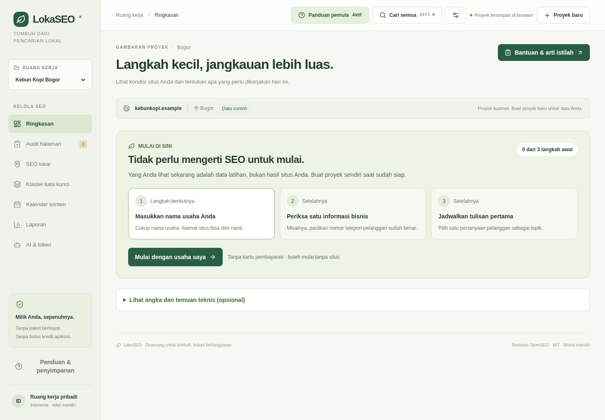

<div align="center">

# LokaSEO

**Ruang kerja SEO berbahasa Indonesia. Mulai manual, gunakan AI bila perlu.**

Audit HTML · SEO lokal · Rencana konten · AI opsional · Pelacakan token

[Mulai](#mulai-dalam-beberapa-langkah) · [Fitur](#apa-yang-bisa-dikerjakan) · [Dokumentasi](#dokumentasi) · [Keamanan](#keamanan-dan-batasan)

</div>

---

LokaSEO membantu pemilik usaha dan pengelola konten menata pekerjaan SEO dalam satu ruang kerja: mencatat informasi bisnis, memeriksa HTML, mengelompokkan kata kunci, dan menjadwalkan tulisan. Antarmuka dan panduannya menggunakan bahasa Indonesia, dengan penjelasan istilah untuk pengguna yang baru mulai.

Proyek ini adalah **fork [OpenSEO](https://github.com/every-app/open-seo)** berlisensi MIT, bukan aplikasi yang seluruhnya dibuat dari nol. LokaSEO menambahkan antarmuka dan alur kerja mandiri yang berbeda, tanpa langganan atau monetisasi aplikasi. Biaya layanan eksternal tetap mengikuti penyedia masing-masing.

## Sumber kode awal

**LokaSEO berasal dari salinan kode [OpenSEO — every-app/open-seo](https://github.com/every-app/open-seo), bukan dibuat seluruhnya dari nol.**

- Versi dasar: [`89e5a00717cdf049b7c2b4e29646edb3a7d4995b`](https://github.com/every-app/open-seo/tree/89e5a00717cdf049b7c2b4e29646edb3a7d4995b).
- Lisensi sumber: **MIT**, dengan pemberitahuan hak cipta asli tetap dipertahankan.
- Fokus perubahan: antarmuka Indonesia, panduan pemula, ruang kerja mandiri, AI opsional, dan penguatan keamanan.

Penjelasan asal kode, gagasan pengembangan, referensi, dan cara mendapatkan salinan awal tersedia di **[Asal Proyek, Sumber Kode, dan Kredit](ASAL-PROYEK.md)**.

> **Status:** modul mandiri telah diuji secara lokal. Backend lengkap upstream tetap tersedia, tetapi belum seluruhnya diverifikasi untuk deployment produksi. Data contoh bukan hasil audit situs atau riset pasar nyata.

## Tampilan



_Tampilan menggunakan proyek contoh, bukan data pelanggan._

## Apa yang bisa dikerjakan?

| Area            | Kemampuan                                                                                                                                         |
| --------------- | ------------------------------------------------------------------------------------------------------------------------------------------------- |
| **Proyek**      | Buat, ubah, dan hapus proyek; **jenis usaha** sebagai kunci utama; pencarian lintas proyek; perlindungan konflik penyimpanan antartab.             |
| **Audit HTML**  | Periksa title, description, H1, robots, canonical, alt, bahasa, viewport, dan indikasi schema bisnis lokal dari HTML yang ditempel atau diunggah. |
| **SEO lokal**   | Checklist manual informasi bisnis dengan panduan untuk pemula.                                                                                    |
| **Kata kunci**  | Kelompokkan kata kunci berdasarkan aturan niat pencarian, tanpa mengklaim data volume atau ranking.                                               |
| **Konten**      | Kalender bulanan, agenda mobile, status tulisan, edit jadwal, dan brief berbasis templat.                                                         |
| **Ekspor**      | Laporan Markdown, CSV, serta cadangan/pemulihan JSON.                                                                                             |
| **AI opsional** | Ide, brief, dan saran SEO menggunakan key sendiri; maksimal lima koneksi berurutan dengan fallback otomatis.                                      |
| **Token**       | Riwayat percobaan, token yang dilaporkan provider, filter, dan ekspor CSV. Angka tidak diketahui tidak dianggap nol.                              |
| **Radar**       | Modul Python (`radar/`) untuk memantau halaman publik pesaing: riwayat lokal, deteksi perubahan harga/rating/isi, papan reputasi lokal, laporan Markdown. Ikut dibundel ke dalam `.exe`, dijalankan dari halaman `/radar`, dan merender halaman ber-JavaScript memakai Edge/Chrome yang sudah terpasang. |

### AI tidak wajib

OpenAI, OpenRouter, DeepSeek, dan Groq didukung melalui endpoint kompatibel OpenAI. AI **nonaktif secara default**. Semua fitur manual tetap bisa digunakan tanpa API key.

Key hanya berada di memori sesi tab dan hilang setelah reload. Key tidak disimpan ke localStorage atau backup proyek, tetapi **tetap melewati server yang Anda jalankan dan provider yang dipilih**. Gunakan hanya server yang Anda percaya. Jawaban AI tidak otomatis diterapkan atau diterbitkan.

### Radar pemantauan situs publik (LokaRadar)

`radar/` adalah modul Python terpisah di dalam repository ini. Ia memantau halaman publik milik pesaing atau mitra, menyimpan riwayatnya **di komputer sendiri**, dan menghasilkan laporan Markdown serta paket wawasan JSON (`lokaradar.insight.v1`) berisi usulan ide konten dan butir ceklis yang bisa dipindahkan ke ruang kerja LokaSEO.

Modul ini memakai **[Scrapling](https://github.com/d4vinci/Scrapling)** dan berjalan lokal tanpa akun atau server: `robots.txt` dihormati per alamat, jeda 2,5 detik per host, User-Agent jujur, dan hanya angka agregat rating yang disimpan (identitas penulis ulasan tidak diambil).

Jenis usaha yang Anda pilih saat membuat proyek (kafe, klinik, bengkel, dan 10 lainnya) menjadi kunci utama radar: dari situ ditentukan data terstruktur yang diperiksa, ambang rating papan reputasi, kata kunci awal, serta pemisahan situs sendiri dari pesaing. Impor setelannya langsung dari cadangan LokaSEO:

```sh
python3 -m lokaradar profil --dari ~/Unduhan/lokaseo-cadangan.json
```

Bila jenis usaha Anda bergantung pada rating (kafe, klinik, penginapan, salon), radar bisa mengambil angka resmi Google Places API memakai kunci Anda sendiri: `python3 -m lokaradar cari "Klinik Gigi" --kota Bogor` lalu `add tempat:<place_id> --kind reputasi`. Pencarian memakai kuota Text Search milik Anda; isi ulasan dan identitas penulisnya tidak pernah diambil.

Situs yang isinya dibuat JavaScript juga tertangani: mode `--render auto` (bawaan) mengambil ulang halaman yang terbaca di bawah 40 kata **dan** terlihat seperti kerangka JavaScript dengan peramban headless (satu peramban untuk seluruh putaran, dan `--tunggu SELEKTOR` bila bagian tertentu muncul belakangan) — pada uji Bogor, satu situs klinik yang semula terbaca 3 kata menjadi 537 kata. `robots.txt` tetap diperiksa lebih dulu, jeda per host dihitung untuk tiap permintaan, dan identitas tetap jujur. Peramban perlu diunduh sekali: `scrapling install`.

Di dalamnya ada **papan reputasi lokal**: peringkat rating dan jumlah ulasan usaha Anda beserta pesaing sekitar, lengkap dengan laju ulasan per minggu dan tanda perhatian. Angkanya bisa berasal dari halaman publik yang memuat `aggregateRating` atau — bila Anda punya kuncinya sendiri — dari **Google Places API** resmi lewat sasaran `tempat:<place_id>`. Halaman Google Maps tidak diambil otomatis karena robots.txt dan ketentuan layanan Google melarangnya. Gratis, tanpa monetisasi.

Radar berjalan dengan **identitas jujur**: User-Agent menyebut nama alatnya, tanpa penyamaran peramban (ada uji yang mengunci itu). Hasil uji lapangan terhadap tujuh usaha Bogor — termasuk temuan bahwa hampir tidak ada usaha lokal memuat rating di situsnya — ada di [`radar/uji-bogor/CATATAN-UJI-BOGOR.md`](radar/uji-bogor/CATATAN-UJI-BOGOR.md).

```sh
pip install "scrapling[fetchers]"
cd radar
python3 -m lokaradar add https://situs-pesaing.example/harga --label "Pesaing"
python3 -m lokaradar run --report
```

Untuk Windows ada **paket siap pakai berisi `LokaSEO-console.exe`** — tanpa Python dan tanpa pemasangan apa pun (lihat `LokaSEO-Windows.zip` di rilis). Paket sumber tetap tersedia bila ingin menjalankan atau membangun sendiri.

Ada tombol **“Periksa kesiapan”** di halaman radar: satu klik memeriksa versi, folder data, peramban, penjadwal, dan pemeriksaan terakhir, lalu menghasilkan laporan teks yang bisa disalin untuk menelusuri masalah. Panduan uji Windows 15 menit ada di `docs/lokaseo/cara-uji-windows.txt`.

Daftar sasaran bisa **diekspor jadi berkas JSON dan diimpor lagi** — untuk pindah komputer, menyimpan cadangan, atau berbagi daftar pesaing. Impor menggabung, tidak pernah menghapus, dan tidak menghubungi situs mana pun.

Halaman yang isinya disusun JavaScript dirender memakai **Microsoft Edge atau Google Chrome yang sudah terpasang di komputer** — tanpa unduhan, tanpa `pip`, tanpa terminal (`radar/lokaradar/peramban.py`, pustaka standar saja). Peramban dicari di jalur pemasangan lazim, registry Windows (`App Paths`), dan `PATH`. **Di Windows nomor versinya dibaca dari berkasnya** (sumber daya versi PE, lalu folder samping bernama nomor versi), bukan dengan menjalankan `chrome.exe --version` — Chrome dan Edge di Windows adalah aplikasi GUI yang tidak menulis ke pipa dan malah bisa membuka jendela peramban (crbug 158372). Pencarian peramban karena itu tidak pernah menjalankan apa pun; bukti bahwa perambannya benar-benar bisa merender ada di tombol "Uji rendering". Bila tidak ada yang bisa dipakai, antarmuka menyebutkan alasannya, menyediakan daftar jalur yang sudah dicari, dan menerima penunjuk berkas dari pengguna. Pemeriksaan diuji sampai ke sisi situs: `robots.txt` diperiksa sebelum peramban dibuka, gambar dan font tidak diunduh, dan identitas tetap `LokaRadar/0.1`.

**Di dalam aplikasi Windows pun radar bisa dipakai tanpa terminal**: buka halaman `/radar` (tautan tersedia di beranda aplikasi), tekan “Periksa sekarang”, lalu lihat perubahan dan laporan di situ. Jenis usaha proyek LokaSEO yang sedang aktif otomatis menjadi kunci kerja radar — ambang rating, data terstruktur yang diharapkan, dan kata kunci awal — sehingga tidak perlu mengatur dua kali. Contoh tampilan halaman itu bisa dibuka tanpa server: [`desktop/contoh/tampilan-radar.html`](desktop/contoh/tampilan-radar.html).

Panduan lengkap, batas sopan santun, dan catatan legalitasnya ada di [`radar/README.md`](radar/README.md). Contoh keluaran: [`radar/contoh/`](radar/contoh/).

## Mulai dalam beberapa langkah

### Prasyarat

- Node.js **24 LTS disarankan** untuk repository ini. Modul mandiri juga telah diuji pada Node.js 20.20.2; backend penuh membutuhkan Node.js 22.15+.
- pnpm **10.30.1**, sesuai `packageManager`.
- Browser modern melalui **localhost atau HTTPS**, agar Web Locks tersedia.

Setelah clone atau mengunduh repository, jalankan dari root:

```sh
npx -y pnpm@10.30.1 install --frozen-lockfile
npx -y pnpm@10.30.1 dev:loka
```

Buka **http://localhost:3000**. Modul mandiri tidak memerlukan database, akun, maupun file `.env` untuk mulai menggunakan fitur manual.

1. Pilih **Mulai dengan usaha saya** dan isi nama proyek.
2. Periksa satu informasi bisnis atau unggah HTML halaman milik Anda.
3. Jadwalkan tulisan pertama di kalender.
4. Unduh cadangan melalui **Laporan**.
5. Jika ingin memakai AI, buka **AI & token → Koneksi & cadangan**.

### Membangun dan menjalankan server mandiri

```sh
pnpm build:loka
pnpm start:loka
```

Build dibuat di `loka-release/`, yang tidak disimpan di Git. Server default menggunakan port 3000; ubah dengan environment variable `PORT`.

Untuk domain sendiri, set `LOKA_PUBLIC_ORIGIN` ke origin HTTPS yang tepat, misalnya `https://seo.domain-anda.example`, tanpa path atau trailing slash. Tambahkan proteksi akses dan rate limiting di reverse proxy. **Server mandiri tidak memiliki login bawaan; jangan mengekspos dev server ke publik.**

Hosting statis tanpa endpoint API hanya menjalankan fitur manual.

## Struktur repository

```text
.github/workflows/              CI LokaSEO, tanpa deployment otomatis
studio/                        Entry point, build config, dan server mandiri
src/client/features/lokaseo/    UI, model, audit HTML, dan penyimpanan browser
src/server/features/loka-ai/    Adapter AI, fallback, dan batas request
src/shared/loka-ai.ts           Kontrak request, response, dan usage AI
radar/lokaradar/               Modul radar pemantauan situs (Python, Scrapling)
radar/tests/                   Uji radar tanpa jaringan (352 uji)
radar/contoh/                  Skrip demo (termasuk demo-render.sh) dan contoh laporan
radar/uji-bogor/               Catatan uji nyata usaha Bogor (basis data tidak ikut Git)
desktop/                       Aplikasi Windows satu berkas .exe (antarmuka di peramban)
desktop/lokaseo_desktop/       Server lokal: halaman, API, AI, keamanan, jembatan radar, penjadwalan
desktop/tests/                 Uji aplikasi desktop tanpa jaringan (214 uji)
desktop/contoh/                Contoh tampilan radar tanpa server
tests/lokaseo/
  browser/                     Smoke test alur pengguna
  security/                    Regresi keamanan dan config tes terpilih
docs/
  assets/                      Gambar dokumentasi publik
  lokaseo/                     Panduan, audit, perubahan, asal fork
  social/                      Materi pengenalan untuk LinkedIn
  maintainers/                 Panduan pemeliharaan upstream
scripts/, deploy/, drizzle/    Tooling, deployment, dan database upstream
plugins/, web/                 Plugin dan situs marketing upstream
```

Unit test tetap berdampingan dengan kode yang diuji. Struktur backend upstream dipertahankan untuk menghindari pemindahan massal yang merusak import, migrasi, atau deployment.

## Pengujian

```sh
pnpm check:loka
pnpm test:loka
pnpm test:loka:upstream-security
pnpm build:loka
```

Untuk tes browser, pasang Chromium lalu jalankan server produksi di terminal terpisah:

```sh
pnpm exec playwright install chromium
# Linux/CI mungkin membutuhkan: pnpm exec playwright install --with-deps chromium
pnpm start:loka
```

Di terminal lain:

```sh
pnpm test:loka:browser
pnpm test:loka:polish
pnpm test:loka:responsive
pnpm test:loka:beginner
pnpm test:loka:ai
pnpm test:loka:radar
pnpm test:loka:peramban
pnpm test:loka:sasaran
pnpm test:loka:kesiapan
pnpm test:loka:security
```

Uji Python tidak butuh jaringan sama sekali:

```sh
cd desktop && python3 -m unittest discover -s tests -t .   # 214 uji aplikasi desktop
cd radar   && python3 -m unittest discover -s tests -t .   # 352 uji radar
```

Verifikasi lokal audit 12 Oktober 2026 mencakup **50 tes modul, 26 tes keamanan upstream terpilih, dan sembilan skrip browser**. Pengujian AI memakai mock, bukan key nyata atau panggilan berbayar. Hasil historis tersebut bukan jaminan semua versi berikutnya akan lulus; jalankan kembali sebelum rilis.

CI yang disediakan menjalankan typecheck modul, tes unit/integrasi, tes upstream terpilih, dan build. CI ini belum dijalankan pada repo GitHub remote dan tidak menggantikan pengujian seluruh backend.

## Keamanan dan batasan

- Proyek disimpan di **localStorage browser**, bukan cloud atau database upstream. Tidak ada sinkronisasi antarperangkat. Menghapus data browser akan menghapus proyek.
- Jika tab lain mengubah proyek, tab usang berhenti menyimpan. Ekspor perubahan sebelum memuat ulang. Riwayat token digabung lintas tab pada origin yang sama.
- Audit HTML **bukan crawler**: tidak mengecek HTTP, robots.txt, X-Robots-Tag, performa, atau DOM hasil eksekusi JavaScript. Skor checklist bukan skor Google.
- Klaster menggunakan aturan sederhana, bukan riset volume pencarian atau clustering semantik.
- Dashboard token bukan sumber tagihan resmi. Koneksi terputus dapat membuat usage tidak tercatat.
- Audit dependency terakhir masih menyisakan advisory `braces` (high) dan `sprintf-js` (moderate) pada jalur upstream. Saat audit belum tersedia patch. Kompatibilitas penuh peer dependency upstream juga belum diverifikasi.
- Jangan memasukkan rahasia ke nama proyek, HTML, atau dokumen yang akan dibagikan. Jangan log request body yang membawa API key.

Baca [laporan keamanan dan batas pengujiannya](docs/lokaseo/security-audit.md) serta [kebijakan pelaporan](SECURITY.md).

## Sistem server lengkap OpenSEO

Kode backend upstream dipertahankan, tetapi data proyek modul mandiri terpisah dari data mesin riset lama. Jalur ini membutuhkan setup tambahan; lihat [pengembangan lokal](docs/LOCAL_DEVELOPMENT.md) dan [self-hosting Cloudflare](docs/SELF_HOSTING_CLOUDFLARE.md).

`local_noauth` hanya untuk lingkungan tepercaya. Untuk akses publik backend penuh, gunakan autentikasi yang sesuai seperti Cloudflare Access. Mode SaaS `hosted` ditolak pada fork ini; layanan pihak ketiga seperti DataForSEO tetap dapat mengenakan biaya sendiri. Docker dan deployment penuh belum diuji end-to-end dalam pengerjaan LokaSEO.

## Aplikasi Windows (antarmuka di peramban, tanpa layanan daring)

LokaSEO dapat dibungkus menjadi satu berkas `.exe` yang menjalankan ruang kerja SEO di
komputer Anda dan membuka antarmukanya sebagai tab di peramban. Tanpa akun, tanpa
jendela aplikasi, tanpa server bersama.

Siap pakai:

1. Buka tab **Actions** di GitHub, pilih alur **LokaSEO desktop (Windows)**, jalankan
   sekali lalu unduh artefak `LokaSEO-Windows-x64`.
2. Ekstrak, lalu klik dua kali `LokaSEO.exe`.
3. Peramban terbuka; ikon LokaSEO muncul di area jam untuk membuka ulang atau
   menghentikan aplikasi. Halaman `http://127.0.0.1:3000/hentikan` juga bisa dipakai
   menghentikan aplikasi bila ikon tray tidak terlihat.

Membangun sendiri di Windows:

```powershell
powershell -ExecutionPolicy Bypass -File desktop\alat\build-windows.ps1
```

- Server hanya mendengarkan `127.0.0.1`; perangkat lain tidak bisa membukanya.
- Tanpa telemetri, tanpa font/CDN eksternal, `connect-src 'self'`, tanpa hak admin.
- AI nonaktif sampai Anda memakainya dengan key sendiri; `--offline` mematikan seluruh
  panggilan AI.
- Berkas `.exe` belum ditandatangani, jadi Windows SmartScreen dapat menampilkan
  peringatan saat pertama dijalankan.
- Menutup tab peramban tidak menghentikan aplikasi; gunakan ikon tray atau halaman
  `/hentikan`.
- **Radar pemantauan situs ikut di dalamnya.** Halaman `/radar` menambah, memeriksa, dan
  menampilkan perubahan sasaran pesaing; datanya di `%APPDATA%\LokaSEO\radar`. Merender
  halaman ber-JavaScript dipakai peramban yang sudah terpasang di komputer (Edge/Chrome), tanpa
  unduhan tambahan.
- **Pemeriksaan otomatis harian.** Satu tombol di halaman radar memasang tugas Windows
  Task Scheduler (`LokaSEO.exe --radar-periksa`, harian atau mingguan, tanpa hak administrator);
  tombol lain menghapusnya. Di luar Windows, halaman itu menampilkan baris cron untuk disalin.

Rincian: [aplikasi desktop](docs/lokaseo/aplikasi-desktop.md).

## Dokumentasi

Dokumentasi utama LokaSEO menggunakan **bahasa Indonesia**. Nama berkas, perintah,
variabel konfigurasi, dan istilah protokol tetap mengikuti kode agar petunjuk dapat
dijalankan. Dokumen teknis warisan OpenSEO yang belum diterjemahkan dipertahankan
dalam bahasa aslinya dan dibedakan dari panduan LokaSEO. Teks lisensi asli tidak diubah.

- [Asal proyek, sumber GitHub awal, dan kredit](ASAL-PROYEK.md)

- [Indeks dokumentasi LokaSEO](docs/lokaseo/README.md)
- [Panduan AI, privasi, dan token](docs/lokaseo/ai-guide.md)
- [Audit bug dan keamanan](docs/lokaseo/security-audit.md)
- [Riwayat pengembangan](docs/lokaseo/changelog.md)
- [Aplikasi desktop lokal](docs/lokaseo/aplikasi-desktop.md)
- [Struktur dan checklist publikasi GitHub](docs/lokaseo/repository-guide.md)
- [Materi LinkedIn](docs/social/linkedin.md)
- [Kontribusi](CONTRIBUTING.md)

## Kredit dan lisensi

LokaSEO merupakan fork [every-app/open-seo](https://github.com/every-app/open-seo). Copyright dan lisensi MIT upstream dipertahankan di [LICENSE](LICENSE); commit sumber dicatat di [upstream-origin.txt](docs/lokaseo/upstream-origin.txt).

Arahan antarmuka dan penulisan juga mengacu pada [make-interfaces-feel-better](https://github.com/jakubkrehel/make-interfaces-feel-better), [better-icons](https://github.com/better-auth/better-icons), [anti-ai-slop-writing](https://github.com/jalaalrd/anti-ai-slop-writing), [superdesign](https://github.com/superdesigndev/superdesign), dan [humanizer](https://github.com/blader/humanizer). Referensi ini tidak menyiratkan afiliasi atau dukungan dari pembuatnya.
